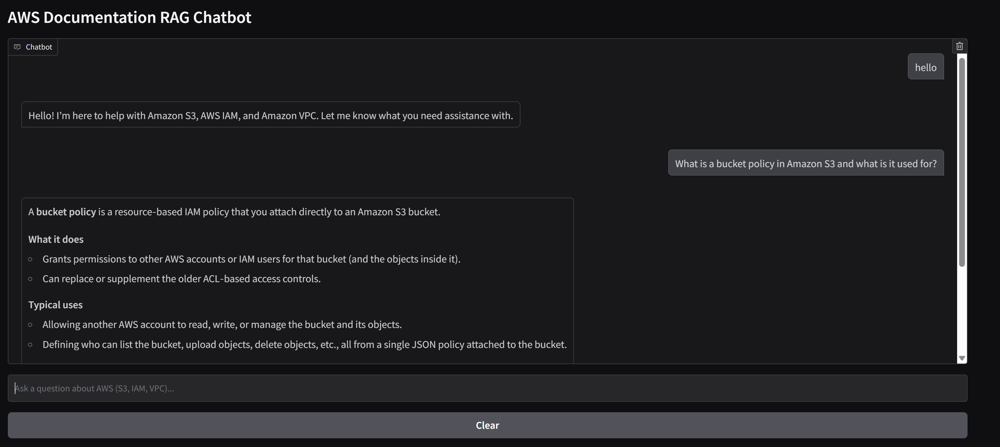
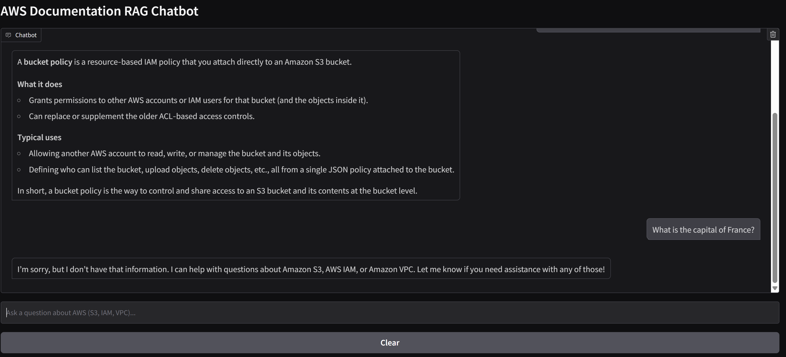

# AWS Documentation RAG Chatbot

A chatbot that answers questions about **AWS** services (S3, IAM, VPC) using the official documentation, built with a **RAG** (Retrieval-Augmented Generation) architecture.

| Greeting and a documentation question | Off-topic question is politely declined |
|---|---|
|  |  |

## How it works

A standalone LLM can hallucinate or miss precise technical details. Here, for every question:

1. the question is converted into a vector (embedding);
2. the 5 most similar documentation chunks are retrieved from a vector database;
3. chunks that are too far from the question are discarded (so greetings and off-topic messages get no context);
4. the remaining chunks are given to the LLM as context, with the instruction to answer only from them.

```text
AWS docs (Markdown)
      |  scripts/build_corpus.py
      v
data/train.jsonl --> chunking (512 chars, 102 overlap) --> embeddings --> ChromaDB
                                                                             |
Question --> embedding --> top-5 nearest chunks <----------------------------+
                                  |
                                  v
                  prompt (context + question) --> LLM --> answer + sources
```

## Tech stack

| Role | Technology |
|---|---|
| Language | Python 3.10+ |
| Embeddings | `sentence-transformers/all-MiniLM-L6-v2` (384 dimensions, runs locally on CPU) |
| Vector database | ChromaDB (persistent, local) |
| Chunking / prompts | LangChain (`RecursiveCharacterTextSplitter`, `ChatPromptTemplate`) |
| LLM | Any OpenAI-compatible API (Groq by default; OpenRouter, Ollama, DeepInfra also work) |
| Interface | CLI and Gradio web UI |

## Setup

```bash
python -m venv venv
source venv/bin/activate        # Windows: venv\Scripts\activate
pip install -r requirements.txt
cp .env.example .env            # Windows: copy .env.example .env
```

Then edit `.env` and set `LLM_API_KEY`. The default provider is [Groq](https://console.groq.com) (free tier available). To use another provider, change `LLM_BASE_URL` and `LLM_MODEL` (examples are in `.env.example`).

## Usage

Run every command from the project root.

1. **Build the corpus** (clones the open-source `awsdocs/*` guides and writes `data/train.jsonl`):

   ```bash
   python scripts/build_corpus.py
   ```

2. **Index it** (chunking, embeddings, creates `chroma_db/`; takes a few minutes on CPU, done once):

   ```bash
   python -m src.embedding
   ```

3. **Run the chatbot**:

   ```bash
   python -m src.main              # command line
   python -m src.main --gradio     # web UI at http://127.0.0.1:7860
   ```

`data/` and `chroma_db/` are not versioned: they are regenerated by steps 1 and 2.

## Project structure

```text
├── scripts/build_corpus.py   # builds data/train.jsonl from the AWS docs
├── src/
│   ├── embedding.py          # loading, chunking, embeddings, Chroma indexing
│   ├── rag.py                # RAGSystem class: retrieve() + generate()
│   ├── main.py               # CLI and Gradio interface
│   └── utils.py              # LLM client (configured through .env)
├── screen1.png, screen2.png  # screenshots used in this README
├── requirements.txt
└── .env.example
```

## Design choices

- **Chunk size 512 / overlap 102 (~20%)**: small enough to keep passages focused, with overlap so an idea is not cut in half.
- **`all-MiniLM-L6-v2`**: lightweight and fast on CPU. The same model must be used for indexing and for queries, otherwise vectors are not comparable.
- **k = 5 retrieved chunks**: a compromise between giving the LLM enough context and adding noise.
- **Distance threshold (0.8)**: chunks farther than this are dropped. Chosen by measuring distances on real questions (0.3-0.75) versus greetings and off-topic text (above 0.9). It is tied to this corpus and embedding model, so it must be re-measured if either changes.
- **Temperature 0.3**: more factual, more deterministic answers, which is what RAG needs.
- **Provider-agnostic LLM client**: because many providers expose an OpenAI-compatible API, switching only requires changing environment variables.

## Data source

AWS user guides published as Markdown in the [awsdocs](https://github.com/awsdocs) GitHub repositories (CC BY-SA 4.0). These repositories are archived; up-to-date documentation lives at [docs.aws.amazon.com](https://docs.aws.amazon.com).

## Limitations and next steps

- No conversation memory: each question is handled independently.
- The distance threshold is a simple heuristic: borderline questions (e.g. about a service missing from the corpus) can still retrieve loosely related chunks.
- `all-MiniLM-L6-v2` is mostly trained on English; a multilingual model (`bge-m3`, `paraphrase-multilingual-MiniLM`) would handle other languages better.
- Possible improvements: reranking, hybrid search (BM25 + vectors), systematic evaluation (recall@k, RAGAS), deployment on AWS (EC2 or Lambda).
